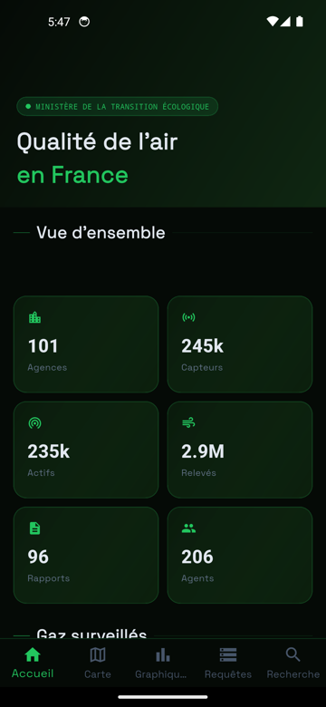
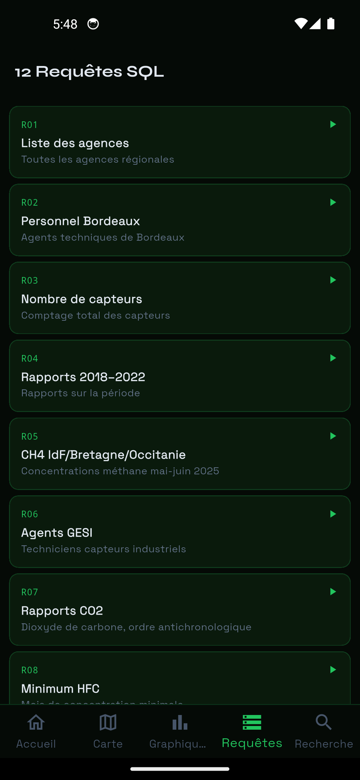
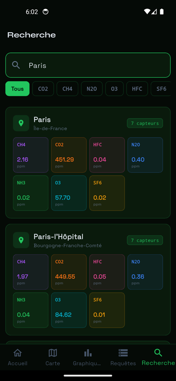

# ClearData App

Application mobile Flutter de surveillance de la qualité de l'air en France, consommant les données d'une base relationnelle de ~2,9 millions de relevés (jeu de données synthétique construit sur les communes INSEE, période mai 2025 – avril 2026).

## Contexte du projet

ClearData App est le client mobile du projet **ClearData**, réalisé dans le cadre de la formation **CESI**. Elle s'appuie sur l'API du site web [cleardata-site.vercel.app](https://cleardata-site.vercel.app) pour afficher, sur mobile, les mêmes données de qualité de l'air que la plateforme web.

## Captures

| Accueil | Requêtes SQL | Recherche |
|---|---|---|
|  |  |  |

## Stack technique

- **[Flutter](https://flutter.dev/)** / **Dart**
- **HTTP** ([package `http`](https://pub.dev/packages/http)) — consommation de l'API REST du site ClearData, aucune connexion directe à une base de données
- **fl_chart** — graphiques et courbes de tendances
- **flutter_map** / **latlong2** — carte interactive
- **cached_network_image**, **shimmer** — chargement et affichage optimisés
- **google_fonts** — typographie

## Fonctionnalités principales

L'application reprend les 5 sections du site web dans une navigation par onglets :

- **Accueil** — vue d'ensemble : nombre d'agences, de capteurs, de relevés, derniers relevés enregistrés
- **Carte** — carte interactive de France avec les concentrations de gaz par ville (coordonnées réelles des communes, fichier `city_coords.json` du site), filtrable par gaz
- **Graphiques** — évolution temporelle des concentrations, comparaisons inter-régions, répartition par gaz
- **Requêtes** — les 12 requêtes SQL du cahier des charges, exécutées en direct sur la base (R05, R07 et R09 adaptées à la période des données, voir le README du site)
- **Recherche** — recherche d'une ville avec ses dernières concentrations relevées, tous gaz confondus

## Chiffres clés

| Donnée | Volume |
|---|---|
| Relevés de concentration | 2 934 540 |
| Capteurs déployés | 244 545 |
| Agences régionales | 101 |
| Gaz surveillés | 7 (CO2, CH4, N2O, O3, HFC, SF6, NH3) |

## API

L'application ne contient aucune logique de base de données : toutes les données sont récupérées via l'API du site web ClearData, hébergée sur Vercel et connectée à TiDB Cloud :

```
https://cleardata-site.vercel.app
```

Voir [`lib/services/api_service.dart`](lib/services/api_service.dart) pour le détail des endpoints consommés (`/api/stats`, `/api/carte`, `/api/graphiques`, `/api/requetes`, `/api/search`).

## Installation et lancement en local

### Prérequis

- [Flutter SDK](https://docs.flutter.dev/get-started/install) 3.27 ou plus récent (Dart >= 3.6) — testé avec Flutter 3.38
- Un émulateur Android/iOS, ou un appareil physique connecté

### Étapes

1. **Cloner le dépôt**

   ```bash
   git clone https://github.com/Raphael-344/cleardata-app.git
   cd cleardata-app
   ```

2. **Installer les dépendances**

   ```bash
   flutter pub get
   ```

3. **Lancer l'application**

   ```bash
   flutter run --dart-define=CARTO_API_KEY=<clé CARTO Basemaps>
   ```

L'application pointe directement vers l'API de production du site ClearData.

### Fond de carte (clé CARTO)

Depuis septembre 2026, les fonds de carte [CARTO Basemaps](https://carto.com/basemaps/apikey) exigent une clé d'API (gratuite jusqu'à 5 M de requêtes par mois en usage non commercial). Elle est passée au build via `--dart-define=CARTO_API_KEY=...` et n'est jamais versionnée. Sans clé, l'application fonctionne mais les tuiles de la carte affichent un filigrane « API KEY REQUIRED ».

## Tester en 2 minutes

1. `flutter run` sur un émulateur Android (ou `flutter build apk --debug` puis installer l'APK).
2. **Accueil** — les compteurs (agences, capteurs, relevés) se chargent ; toucher « 12 Requêtes SQL » ouvre l'onglet correspondant.
3. **Requêtes** — lancer R05, R07 ou R09.
4. **Recherche** — taper « Paris ».
5. **Carte** — les villes apparaissent sur la France (premier chargement : ~20 s, le fichier de coordonnées pèse ~1 Mo).
